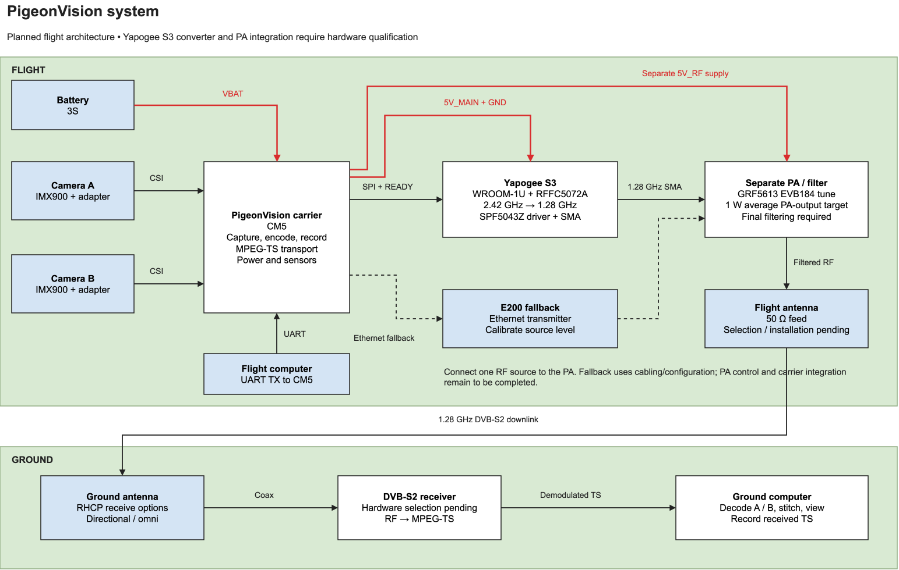

# Hardware

One CM5 captures two fisheye cameras. SPI feeds [Yapogee S3](yapogee-s3/README.md): an ESP32-S3 makes DVB-S2 at 2.42 GHz, then an integrated mixer/LO converts it to the flight band near 1.28 GHz. A separate PA/filter board feeds the antenna. Ethernet supports an E200 fallback. The flight ground receiver remains to be selected and qualified.

[Edit diagram](system.drawio)

The diagram shows the planned system: WROOM-1U waveform generation, RFFC5072A conversion, an onboard SPF5043Z driver and a separately powered GRF5613 PA/filter. Carrier wiring and software startup still need reconciliation with the [Yapogee S3 interface](yapogee-s3/interfaces.md).

- [Carrier](carrier/README.md): compute, cameras, power and sensors.
- [Yapogee S3](yapogee-s3/README.md): WROOM modem, integrated RF converter, main/quiet supplies and 5 V interface.
- [RF frontend](rf-frontend/README.md): separate PA, final filter and antenna interface.
- [Project library](libraries/README.md): KiCad parts and CM5 placement.

Use one flight transmitter at a time, connected by SMA coax to the separate PA/filter board. Swap cables/configuration for the E200 fallback. The diagrams show the planned interfaces, not a completed schematic.
