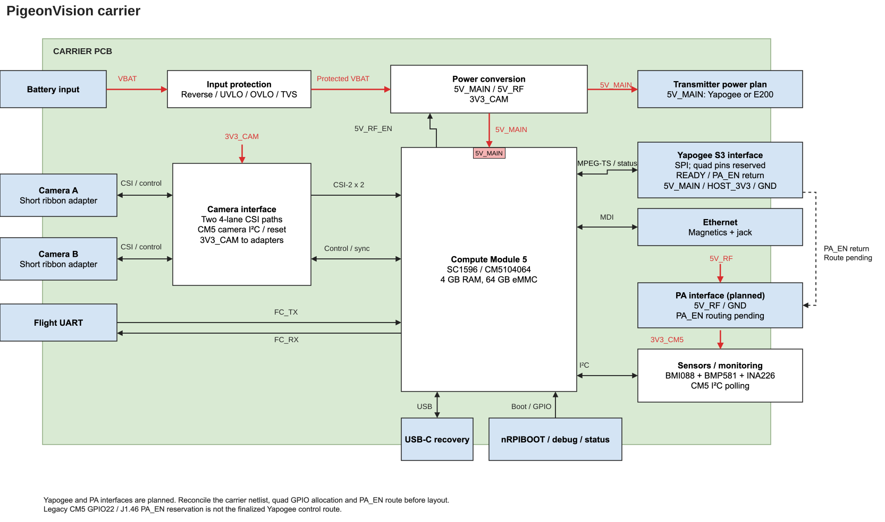

# Carrier

**Current plan:** one CM5, two cameras, SPI to [Yapogee S3](../yapogee-s3/README.md) and Ethernet for service or the E200 fallback. Yapogee uses an ESP32-S3-WROOM-1U-N16R8 module and converts its RF output to 1.28 GHz; the PA/filter is a separate board. Record to eMMC. Use a 3S 5 Ah battery; one hour including pad time is a planning target. Carrier diameter is 5.7 in (144.78 mm). The transmitter and PA interfaces still need carrier schematic integration.

[Edit diagram](block-diagram.drawio) · [KiCad project](PigeonCarrier/PigeonCarrier.kicad_pro) · [Design master](../../calculations/design-master.xlsx)

| Block | Parts / connection |
| --- | --- |
| Compute | SC1596 / CM5104064: 4 GB RAM, 64 GB eMMC |
| CM5 connectors | 2 × Amphenol 10164227-1001A1RLF, 1.5 mm stack |
| Cameras | 2 × FRAMOS IMX900 + CIL212; retain the working FRAMOS adapters. J7/J8 use vertical Hirose FH12-22S-0.5SVA(54) FFC connectors with CM5IO-style pinout |
| Input protection | LM74502DDFR, 2 × CSD18540Q5B, SMBJ18CA; unfused input |
| Main 5 V | LM61495RPHR; CM5 and Yapogee, with E200 as an alternate transmitter |
| RF 5 V | TPS62933FDRLR; separate supply, default off |
| Camera rail | TPS62933FDRLR: shared 3V3_CAM from VBAT, enabled by 3V3_CM5; adapter boards provide camera-specific rails |
| Battery monitor | INA226AIDGSR + WSL25125L000FEA18, 5 mΩ |
| Sensors | BMI088, BMP581 and INA226 on CM5 GPIO2/3 I²C; polling without interrupt wiring |
| Camera control | Dedicated CM5 camera I²C lines; CAM0_RST from J1.97 and CAM1_RST from J1.100. Synchronization access reserved, synchronized exposures not required |
| Ethernet | EDAC A70-112-331N126 with integrated magnetics |
| Service | USB-C data/recovery, nRPIBOOT shunt, PWR_BUT button, J12 debug UART and CM5 activity LED on carrier; separate USB-C, BOOT, reset and UART access on Yapogee |
| Flight UART | Receive required; return TX optional. Logic voltage, connector and protocol TBD |

Both camera connectors receive the shared 3V3_CAM rail; MIPI connects directly to CM5. Keep the working adapter boards and their camera-specific power sequencing. The carrier does not replace their internal regulator circuitry.

Sensors use CM5 3.3 V. Yapogee receives 5V_MAIN through castellations and makes its own 3.328 V main and quiet 3.0 V rails. Reserve 1.5 A for the daughterboard. Its USB-C port also supports standalone power from a source advertising at least 1.5 A; eligible USB has priority when both sources are present. The selected GRF5613 PA uses the separate switched 5V_RF rail. Keep space, 5 V power and Ethernet for the E200 fallback. The bench input is a PJ-102AH barrel jack beside the battery connector, used with the battery unplugged.

J1 uses vertical AMASS XT60PB-M30.G.Y: pin 1, at the keyed end marked −, is GND; pin 2, at the flat end marked +, is VBAT_RAW. J6 and both camera connectors are also vertical. USB-C J10 and the PJ-102AH bench input J2 remain horizontal. [Connector geometry, sourcing and model limits](../libraries/review/vertical-connectors.md).

The planned Yapogee connection uses 16 castellated interface positions plus three GND anchors. [Pad assignment and mechanical contract](../yapogee-s3/interfaces.md). The daughterboard takes SCLK, CS_N and D0–D3; READY and PA_EN return to the carrier. HOST_3V3 is the translators' carrier-side reference, separate from Yapogee's local regulator output.

The existing CM5 reservations are retained as the starting point for SPI integration. J1 numbers below are module-connector pads, not IO-board header positions. These carrier connections are not yet implemented.

| Signal | CM5 GPIO reservation | CM5 J1 pad | Yapogee castellation |
| --- | --- | --- | --- |
| SCLK | 11 | 38 | 2 |
| D0 / MOSI | 10 | 44 | 5 |
| CS_N | 8 | 39 | 4 |
| READY | 25 | 41 | 11 |
| D1–D3 | Pending carrier allocation | Pending | 7, 8, 10 |
| PA_EN return | Pending carrier routing | Pending | 13 |
| HOST_3V3 | CM5 3.3 V reference | Supply connection pending | 14 |
| 5V_CARRIER | 5V_MAIN | Supply connection pending | 16 |

SPI is the baseline transport; the quad data pins are reserved for future implementation. The measured 20 MHz mode-0 PV-SPI bench results belong to the earlier Pico path. Its framing, READY behavior, startup and uncertain-transfer recovery require reconciliation with the ESP32 firmware before treating that result as S3 integration evidence. Keep sensors off this dedicated bus. [Measured SPI result](../../software/flight/spi.md).

The RF buck enable remains GPIO17 / J1.50 with its existing 10 kΩ pull-down. The earlier CM5 GPIO22 / J1.46 PA_EN reservation has not been wired. The new Yapogee contract returns PA_EN on castellation 13; resolve that route and any host monitoring/interlock before connecting the PA. Do not connect two actively driven enable sources together.

The proposed four-pin Molex 0430450418 PA connector carries 1: 5V_RF, 2: GND, 3: PA_EN, 4: GND. Local PA circuitry must default off and handle GRF5613 shutdown polarity and bias sequencing. This remains a pin plan with no carrier control wiring applied. [PA plan](../rf-frontend/README.md). The transmitter's standalone USB source selection and reverse blocking are on Yapogee; source transitions and carrier backfeed still need hardware checks.

J12 is a JST SH BM03B-SRSS-TB debug UART on CM5 GPIO14/15 using the Raspberry Pi debug-connector pinout: 1 RX into the CM5 (GPIO15), 2 GND, 3 TX from the CM5 (GPIO14). A Raspberry Pi Debug Probe plugs in with a straight-through cable. Both lines have 1 kΩ series resistors. The specification calls for 100 Ω, but CM5 GPIO pads are not failsafe, so the larger value limits back-feed from a powered probe into an unpowered CM5. LED4 (via R41, 220 Ω from 3V3_CM5) shows CM5 activity on LED_nACT.

CM5 configuration implied by this carrier: set `PSU_MAX_CURRENT=5000` in the bootloader EEPROM, because CC1/CC2 are unconnected and no USB-PD negotiation occurs. Set `enable_uart=1` for a Linux console on J12. Set `force_eeprom_read=0`, because ID_SD/ID_SC carry the CAM1 I²C bus.

Power control: J6 on Regulators uses vertical AMASS XT30UPB-M.G.Y. Pin 1 connects directly to U1 pin 1 (EN/UVLO / PWR_EN); pin 2 is GND. This dry-contact switch intentionally uses the connector's −-marked end for PWR_EN and +-marked end for GND; the moulded signs do not describe supply polarity. Use the microswitch COM and NO terminals: with the pin inserted and the lever pressed, closed contacts ground EN/UVLO and turn power off. Removing the pin releases the lever and opens the contact, allowing the existing UVLO divider to enable power. Confirm that the actual mechanism gives these contact states. An unplugged switch also allows power. This is not a latch: shut down the CM5 before reinserting the pin.

Q4, R39 and R40 were removed from the schematic and unrouted PCB. At 12.6 V, the closed contact carries 12.6 V / 7.5 kΩ = 1.68 mA through R2; R2 dissipates 21.2 mW. The existing UVLO and OV dividers remain unchanged. Total off-state divider draw is about 1.89 mA, plus controller current and leakage. Off disables downstream battery power; it does not isolate the battery or eliminate standby current. Switch contact quality, bounce and startup remain bench checks. [LM74502 datasheet](https://www.ti.com/lit/ds/symlink/lm74502.pdf).

Camera, sensor, Ethernet and USB/service hierarchy is connected, along with CM5 power/grounds and both regulator enables. The carrier USB-C port uses host VBUS only for data-switch control, with no connection to the battery or 5 V power rail. Its ESD footprint uses explicit external copper connections from each protected pad to the opposite NC pad. USB enumeration, recovery and power transitions remain hardware checks. The cooler fan header uses the native CM5 PWM/tach interface with 5V_MAIN supply; transmitter/Yapogee and PA interfaces still need completion.

The 2026-10-06 direct-switch check reports no ERC errors or warnings. All 200 CM5 contacts are connected or intentionally marked unused; all 147 components and 670 numbered PCB pads matched the exported schematic at that time (152 components after the 2026-10-07 additions; schematic parity remains clean). The switch change affects only J6.1 among the retained component connections. [Switch verification](../../build/pull-pin-direct-2026-10-06/verification.json). Unwired pins reserved for SPI and PA_EN currently have no-connect marks; replace those marks with the RF interface wiring when it is finalized. Power-source flags identify feeds through passive parts, including U7's internally charged bootstrap node. The review does not establish hardware performance: switch contact states, camera adapter current/sequencing, XT60 revision/fit, power transitions and final layout remain to be checked. [Connection review](../../build/carrier-closeout-2026-10-05/connection-review.json) · [Footprint review](../../build/carrier-closeout-2026-10-05/all-footprints-audit.json).

The design master still budgets E200 power. Reconcile it with the accepted 1.5 A Yapogee allocation on 5V_MAIN, keeping E200 as an alternative rather than adding both transmitter loads to one flight configuration. GRF5613 is selected for PA planning; its loaded current and thermal performance remain unmeasured. Confirm mounting and connector access before final layout.

[Library and sourcing](../libraries/README.md) · [CM5 datasheet](https://datasheets.raspberrypi.com/cm5/cm5-datasheet.pdf) · [Camera datasheet](https://www.mouser.com/catalog/specsheets/FRAMOS_2-12-2026_FSM.GO-IMX900_Datasheet_v1.2a.pdf)
