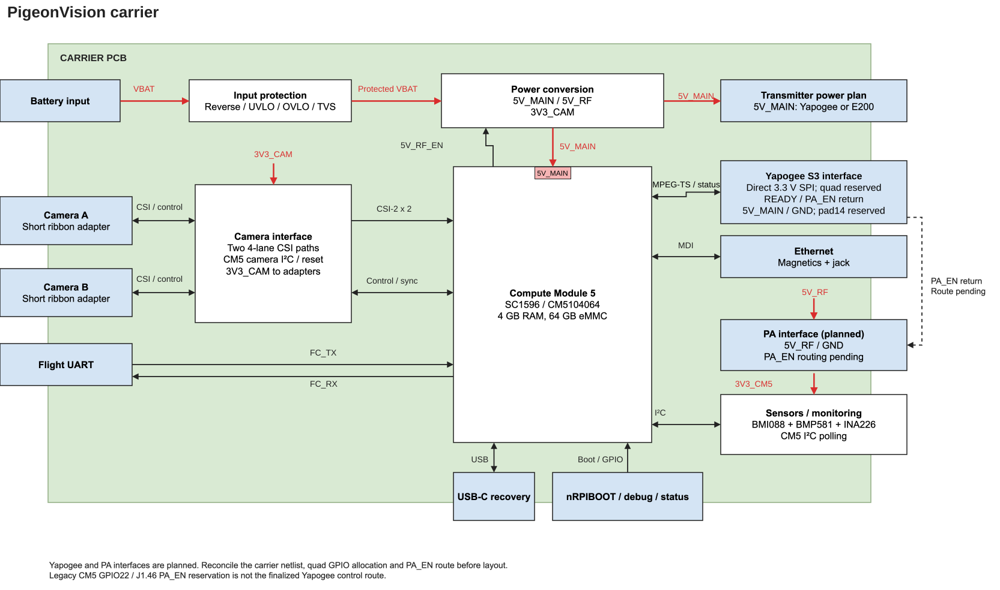

# Carrier

[Rev 1.1 fabrication and assembly files](production/Rev1.1/README.md)

**Current plan:** one CM5, two cameras, SPI to [Yapogee S3](../yapogee-s3/README.md) and Ethernet for service or the E200 fallback. Yapogee uses an ESP32-S3-WROOM-1U-N16R8 module and converts its RF output to 1.28 GHz. The PA and filter are on a separate board. Record to eMMC. Use a 3S 5 Ah battery with a one-hour planning target including pad time. Carrier diameter is 5.7 in (144.78 mm).

[Edit diagram](block-diagram.drawio) · [KiCad project](PigeonCarrier/PigeonCarrier.kicad_pro) · [Design master](../../calculations/design-master.xlsx)

| Block | Parts / connection |
| --- | --- |
| Compute | SC1596 / CM5104064: 4 GB RAM, 64 GB eMMC |
| CM5 connectors | 2 × Amphenol 10164227-1001A1RLF, 1.5 mm stack |
| Cameras | 2 × FRAMOS IMX900 + CIL212; retain the working FRAMOS adapters. J7/J8 use vertical Hirose FH12-22S-0.5SVA(54) FFC connectors with CM5IO-style pinout |
| Input protection | LM74502DDFR, 2 × CSD18540Q5B, SMBJ18CA; unfused input |
| Main 5 V | LM61495RPHR; CM5 and Yapogee, with E200 as an alternate transmitter |
| RF 5 V | TPS62933FDRLR; separate supply, default off |
| Camera rail | TPS62933FDRLR: shared 3V3_CAM from VBAT, enabled by 3V3_CM5; adapter boards provide camera-specific rails |
| Battery monitor | INA226AIDGSR + WSL25125L000FEA18, 5 mΩ |
| Sensors | BMI088, BMP581 and INA226 on CM5 GPIO2/3 I²C; polling without interrupt wiring |
| Camera control | Dedicated CM5 camera I²C lines; CAM0_RST from J1.97 and CAM1_RST from J1.100. Synchronization access reserved, synchronized exposures not required |
| Ethernet | EDAC A70-112-331N126 with integrated magnetics |
| Service | USB-C data/recovery, nRPIBOOT shunt, PWR_BUT button, J12 debug UART and CM5 activity LED on carrier; separate USB-C, BOOT, reset and UART access on Yapogee |
| Flight UART | Receive required; return TX optional. Logic voltage, connector and protocol TBD |

Both camera connectors receive the shared 3V3_CAM rail; MIPI connects directly to CM5. Keep the working adapter boards and their camera-specific power sequencing. The carrier does not replace their internal regulator circuitry.

Sensors use CM5 3.3 V. Yapogee receives 5V_MAIN through castellations and makes its own 3.328 V main and quiet 3.0 V rails. Reserve 1.5 A for the daughterboard. Its USB-C port supports standalone power before installation from a known 5 V source providing at least 1.5 A. Once mounted, leave JP1 open and use USB for data only while the carrier is on. Independent Pi PMIC-off operation is unsupported. The selected GRF5613 PA uses the separate switched 5V_RF rail. Keep space, 5 V power and Ethernet for the E200 fallback. The bench input is a PJ-102AH barrel jack beside the battery connector, used with the battery unplugged.

J1 uses vertical AMASS XT60PB-M30.G.Y: pin 1, at the keyed end marked −, is GND; pin 2, at the flat end marked +, is VBAT_RAW. J6 and both camera connectors are also vertical. USB-C J10 and the PJ-102AH bench input J2 remain horizontal. [Connector geometry, sourcing and model limits](../libraries/review/vertical-connectors.md).

J13 is the 55 × 43.18 mm Yapogee landing below the CM5. Its 28 lands match the module castellations, including twelve extra GND anchors. The footprint omits paste for hand soldering. The closed SMA pocket measures 33 × 12 mm with R1.5 corners and leaves about 11.3 mm of board at the narrowest point of the outer rim. It clears the body of the Amphenol 135103-01-06.00 elbow as it first meets the jack with the cable pointing up. Check the mating sequence, wrench access and cable bend in the flight stack before fabrication. [Cable assembly](https://www.amphenolrf.com/en-us/part/135103-01-06-00/5975/) The E200 stays available as a separate placement option. [Module interface](../yapogee-s3/interfaces.md)

| Signal | CM5 GPIO | CM5 J3 pad | Yapogee J1 / carrier J13 pad |
| --- | ---: | ---: | ---: |
| SCLK | 11 | 38 | 2 |
| D0 / MOSI | 10 | 44 | 5 |
| D1 | 9 | 40 | 7 |
| CS_N | 8 | 39 | 4 |
| READY | 25 | 41 | 11 |
| PA request into Pi | 22 | 46 | 13 |
| 5V_MAIN | — | — | 3 |
| D2 and D3, reserved for quad | — | — | 8, 10 |
| Reserved | — | — | 14 |

R42 pulls CS_N up to 3V3_CM5 with 4.7 kΩ. The CM5 and Yapogee share ground and use direct 3.3 V I/O. Power the installed Yapogee from 5V_MAIN and keep JP1 open. Coordinate GPIO startup and shutdown to avoid driving an unpowered endpoint.

Single-lane SPI0 is the bring-up mode. D1 provides a path to dual transmit with driver and firmware changes. Native SPI0 quad needs GPIO0 and GPIO1, which are assigned to CAM1 I²C. A quad implementation needs a different pin or host-peripheral plan and bench validation. [CM5 GPIO mux](https://datasheets.raspberrypi.com/cm5/cm5-datasheet.pdf)

GPIO17 / J3.50 switches the RF buck through 5V_RF_EN and retains its 10 kΩ pull-down. GPIO22 / J3.46 receives the Yapogee request. GPIO23 / J3.47 drives the separate, active-high PA_BIAS_EN signal.

The top sheet shows the six CM5-to-Yapogee signals and the separate PA bias enable wire. J14 is the vertical Molex 0430450418 Micro-Fit 3.0 header. Pin 1 supplies 5V_RF (4.88 V nominal), pins 2 and 4 are ground, and pin 3 carries PA_BIAS_EN. The PA board pulls pin 3 low by default and handles the GRF5613 shutdown polarity locally. J14 sits beside the RF buck and uses the same Molex STEP model as the PA board. PA control firmware remains pending. [PA harness and power](../rf-frontend/README.md)

J12 is a JST SH BM03B-SRSS-TB debug UART on CM5 GPIO14/15 using the Raspberry Pi debug-connector pinout: 1 RX into the CM5 (GPIO15), 2 GND, 3 TX from the CM5 (GPIO14). A Raspberry Pi Debug Probe plugs in with a straight-through cable. Both lines have 1 kΩ series resistors. The specification calls for 100 Ω, but CM5 GPIO pads are not failsafe, so the larger value limits back-feed from a powered probe into an unpowered CM5. LED4 (via R41, 220 Ω from 3V3_CM5) shows CM5 activity on LED_nACT.

CM5 configuration implied by this carrier: set `PSU_MAX_CURRENT=5000` in the bootloader EEPROM, because CC1/CC2 are unconnected and no USB-PD negotiation occurs. Set `enable_uart=1` for a Linux console on J12. Set `force_eeprom_read=0`, because ID_SD/ID_SC carry the CAM1 I²C bus.

Power control: J6 on Regulators uses vertical AMASS XT30UPB-M.G.Y. Pin 1 connects directly to U1 pin 1 (EN/UVLO / PWR_EN); pin 2 is GND. This dry-contact switch intentionally uses the connector's −-marked end for PWR_EN and +-marked end for GND; the moulded signs do not describe supply polarity. Use the microswitch COM and NO terminals: with the pin inserted and the lever pressed, closed contacts ground EN/UVLO and turn power off. Removing the pin releases the lever and opens the contact, allowing the existing UVLO divider to enable power. Confirm that the actual mechanism gives these contact states. An unplugged switch also allows power. This is not a latch: shut down the CM5 before reinserting the pin.

Q4, R39 and R40 were removed from the schematic and unrouted PCB. At 12.6 V, the closed contact carries 12.6 V / 7.5 kΩ = 1.68 mA through R2; R2 dissipates 21.2 mW. The existing UVLO and OV dividers remain unchanged. Total off-state divider draw is about 1.89 mA, plus controller current and leakage. Off disables downstream battery power; it does not isolate the battery or eliminate standby current. Switch contact quality, bounce and startup remain bench checks. [LM74502 datasheet](https://www.ti.com/lit/ds/symlink/lm74502.pdf).

Camera, sensor, Ethernet and USB/service hierarchy is connected, along with CM5 power/grounds and both regulator enables. The carrier USB-C port uses host VBUS only for data-switch control, with no connection to the battery or 5 V power rail. Its ESD footprint uses explicit external copper connections from each protected pad to the opposite NC pad. USB enumeration, recovery and power transitions remain hardware checks. The cooler fan header uses the native CM5 PWM/tach interface with 5V_MAIN supply.

The 2026-10-06 direct-switch check reported no ERC errors or warnings. All 200 CM5 contacts were connected or intentionally marked unused. The switch change affected only J6.1 among the retained component connections. Power-source flags identify feeds through passive parts, including U7's internally charged bootstrap node. Switch contact states, camera adapter current and sequencing, XT60 fit, power transitions and final layout remain to be checked. [Switch verification](../../build/pull-pin-direct-2026-10-06/verification.json) · [Connection review](../../build/carrier-closeout-2026-10-05/connection-review.json) · [Footprint review](../../build/carrier-closeout-2026-10-05/all-footprints-audit.json)

## Routing

Use **JLC06161H-3313**, 1.6 mm nominal, 1 oz outer and 0.5 oz inner copper. Route signals on F.Cu, L3 (In2.Cu) and B.Cu. Reserve L2 (In1.Cu), L4 (In3.Cu) and L5 (In4.Cu) for continuous GND. Add and fill those zones during layout.

| Net class | Outer width / gap | L3 width / gap | P/N skew |
| --- | --- | --- | --- |
| CSI and Ethernet, 100 Ω | 0.150 / 0.500 mm | 0.125 / 0.300 mm | 0.15 mm max |
| USB 2.0, 90 Ω | 0.175 / 0.300 mm | 0.160 / 0.300 mm | 0.15 mm max |
| Single ended, 50 Ω | 0.160 mm | 0.140 mm | n/a |

Layer rules select the L3 geometry automatically. SPI SCLK, D0, D1 and CS_N use SE_50R; I²C, UART and slow controls keep their normal classes. Power widths remain starting values: 1.50 mm battery, 1.00 mm 5 V and 0.50 mm 3.3 V. Use short outer-layer pours for the high-current paths.

Route CAM1 west of the SMA pocket. Keep the CM5 launch short before opening to the ordinary pair gap. Copper-to-edge clearance remains 0.50 mm. Use 0.45 mm via lands with 0.30 mm drills for controlled-impedance nets and 0.60 / 0.30 mm for general routing. The smaller vias fit the camera connector lands but need a staggered escape from the 0.20 mm-wide CM5 lands. No blind, buried or laser microvias are enabled.

The outer model references L2 or L5; L3 references L2 and L4. Keep other same-layer copper 0.50 mm away outside the reviewed launches. Match P/N within each pair and keep each camera's long runs on the same layer where practical. Review clock-to-data skew before tuning; the CM5 datasheet provides no numeric CSI interlane limit. [Calculations](routing-plan.json) · [Fabrication notes](fabrication-notes.md) · [CM5 datasheet](https://datasheets.raspberrypi.com/cm5/cm5-datasheet.pdf)

The BMP581 uses the shared solder mask opening recommended by Bosch. Keep exposed copper under the sensor limited to its intended pads and escapes. [BMP581 datasheet](https://www.bosch-sensortec.com/media/boschsensortec/downloads/datasheets/bst-bmp581-ds004.pdf)

The design master still budgets E200 power. Reconcile it with the accepted 1.5 A Yapogee allocation on 5V_MAIN, keeping E200 as an alternative rather than adding both transmitter loads to one flight configuration. GRF5613 is selected for PA planning; its loaded current and thermal performance remain unmeasured. Confirm mounting and connector access before final layout.

[Library and sourcing](../libraries/README.md) · [CM5 datasheet](https://datasheets.raspberrypi.com/cm5/cm5-datasheet.pdf) · [Camera datasheet](https://www.mouser.com/catalog/specsheets/FRAMOS_2-12-2026_FSM.GO-IMX900_Datasheet_v1.2a.pdf)
