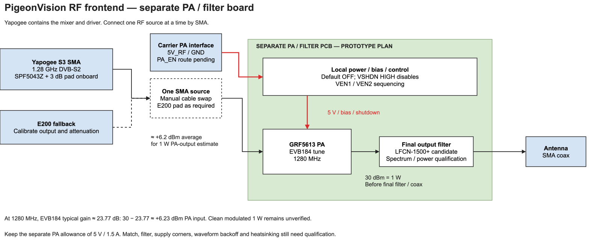

# RF frontend

**Current plan:** [Yapogee S3](../yapogee-s3/README.md) SMA output → separate GRF5613 PA → final filter → antenna, initially at 1.28 GHz. Use **1 W average at the PA output** as the present gain-budget target; clean 1–2 W DVB-S2 output remains unqualified. Ethernet/E200 is the alternate source, connected one source at a time by SMA cable.

[Edit diagram](block-diagram.drawio) · [Yapogee signal and power plan](../yapogee-s3/README.md) · [Link budget](../../calculations/link-budget.xlsx)

Yapogee contains the ESP32-S3-WROOM-1U module, short U.FL link, input pad/balun, RFFC5072A converter, LFCN-1450+ filter and SPF5043Z driver with a 3 dB output pad. Its 3.70 GHz LO converts 2.42 GHz to 1.28 GHz and reverses the complex spectrum; transmit IQ conjugation or corresponding receiver handling is required. The baseline uses that onboard driver to feed the separate PA.

| Stage / reference plane | Current basis |
| --- | --- |
| PA input | Approximately +6.2 dBm average for the 1 W PA-output estimate; the Yapogee SMA output must also cover external interconnect loss |
| PA | GRF5613, EVB184 1240–1420 MHz reference tune |
| PA output | +30 dBm = 1 W planning target, before final filter and antenna coax |
| Final filter | LFCN-1500+ candidate; verify spectrum, insertion loss, RF power and temperature |
| E200 fallback | Measure source power and waveform peaks; fit attenuation as required for the PA input |

EVB184 typical gain interpolates to about 23.77 dB at 1280 MHz, so 30 − 23.77 ≈ +6.23 dBm PA input. The same tune's typical CW output P1dB is about +33.7 dBm there. Pulse-shaped QPSK and 8PSK have waveform-dependent peaks; these CW numbers do not establish clean 1 W modulated output. Measure crest factor, gain, MER/EVM, spectral regrowth and temperature, then set backoff. A 1 dB final-filter loss would leave approximately 0.79 W from a 1 W PA output, before antenna-coax loss.

The preferred mechanical concept remains a PA daughterboard soldered to a carrier GND contact area, with thermal vias through both boards and a TIM-coupled heatsink below the carrier. Preserve ground copper beneath the PA. Mounting geometry, contact area and heat rejection remain unverified. Two low-profile heatsink planning footprints and envelope models are available in the [project library](../libraries/README.md), targeting 12.7 mm total underside clearance.

The optional breakout interface is a planned four-circuit Molex **0430450418** Micro-Fit 3.0 connector. The same power/control signals are needed for the soldered module; its lands have not been defined. No PA connector or control wiring has been added to the carrier schematic.

| Connector pin | Signal | Planned connection |
| --- | --- | --- |
| 1 | 5V_RF | Switched carrier RF buck output |
| 2 | GND | Power return |
| 3 | PA_EN | 3.3 V active-high request; Yapogee castellation 13 returns this signal, carrier route pending |
| 4 | GND | Control return; common with pin 2 |

The earlier CM5 GPIO22 / J1.46 direct PA_EN reservation is not wired. Reconcile it with the Yapogee return signal and any host interlock; do not join two active outputs. CM5 GPIO17 / J1.50 separately controls the RF buck through **5V_RF_EN**. Keep the **1.5 A / 7.5 W** PA planning allowance until loaded measurements are available. This supply is separate from Yapogee's 5 V input and local regulators. The TPS62933 IC's 3 A rating does not establish the assembled carrier rail's continuous thermal capacity. EVB184 reports approximately 309 mA quiescent current at 5 V, which is not the loaded maximum.

The PA board provides RF chokes, decoupling, matching, bias resistors, shutdown logic and a thermal path from the exposed pad. Its PA_EN input should have a 10 kΩ pull-down and keep the PA off when the carrier is unpowered or the cable is disconnected. GRF5613 **VSHDN is high to disable**, so local circuitry must handle this polarity and VEN1 / VEN2 sequencing; do not connect the bias pins directly to a GPIO. Mute RF before changing PA bias or rail power. Use EVB184's layout and matching as the starting point; its distributed matching cannot be copied to an arbitrary stackup without review.

The existing RF divider remains **R14 = 51 kΩ, R21 = 1.5 kΩ, R22 = 10 kΩ**, giving 5.000 V nominal. At an assumed 125°C resistor temperature, ±1% initial tolerance, opposite ±100 ppm/°C drift, 0.816 V maximum feedback reference and 0.15 µA maximum feedback input current give a **5.283 V static upper corner**, above the GRF5613's **5.25 V** supply ceiling. Changing R21 to 0 Ω is a **4.880 V nominal candidate**, with a 5.155 V upper corner under the same assumptions. That change is not applied. These calculations exclude ripple, startup and load-release transients; PA supply compliance and RF performance at the lower voltage need measurement. See the RF regulator calculation in [Design Master](../../calculations/design-master.xlsx).

SMA input/output. The final filter follows the PA and must be selected for the actual output spectrum and power. It cannot repair distortion already produced by clipping. RF matching, supply compliance, loaded current, shutdown sequencing and heatsinking remain hardware work.

[GRF5613 datasheet](https://www.guerrilla-rf.com/includes/prodFiles/5613/GRF5613DS.pdf) · [GRF5613 EVB184 tune](https://www.guerrilla-rf.com/includes/prodFiles/5613/GRF5613%20EVB184%201240-1420%20MHz.pdf) · [LFCN-1500+](https://www.minicircuits.com/pdfs/LFCN-1500%2B.pdf) · [Molex 0430450418](https://www.digikey.com/en/products/detail/molex/0430450418/2467320)
