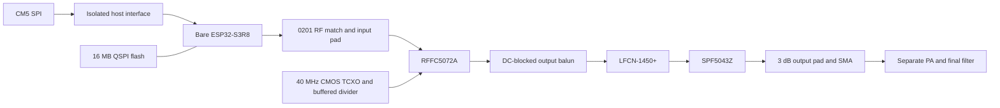

# Yapogee S3

Bare ESP32-S3 DVB-S2 transmitter daughterboard for PigeonVision. The CM5 supplies MPEG-TS over SPI; quad data pins are reserved. The S3 pulse-shapes the waveform through its 2.42 GHz radio. RFFC5072A converts it to 1.28 GHz using a 3.70 GHz LO; SPF5043Z drives the separate PA/filter board. High-side conversion requires transmit IQ conjugation or equivalent receiver handling.

Open the [KiCad project](kicad/YapogeeS3.kicad_pro). The schematic is unwired. The PCB has a mechanical starting envelope, edge interface, shield frame, SMA and USB connector; circuit placement and routing remain.

[Circuit BOM](BOM.csv) · [BOM by MPN](BOM_by_MPN.csv) · [Mechanical BOM](BOM_mechanical.csv) · [Interfaces](interfaces.md)

| Block | Selected part |
| --- | --- |
| MCU / PSRAM | Bare ESP32-S3R8; 8 MB in-package octal PSRAM |
| Flash / MCU crystal | W25Q128JVSIQ; ABM8-40.000MHZ-10-D1G-T |
| Converter / reference | RFFC5072ATR13; ATXAIG-H13-F-40.000MHZ-F25-T3 with 74LVC1G34GV,125 |
| RF driver / filter | SPF5043Z; LFCN-1450+ |
| Digital / quiet RF supply | TPS62933FDRLR, nominal 3.456 V; TPS7A2030PDBVR, 3.0 V |
| Source selection / USB detection | TPS2116DRLR; STUSB4500LQTR and SN74LVC1G97DBVR |
| Output / shield | SMA-J-P-H-ST-EM3; BMI-S-206-F frame and BMI-S-206-C lid |

USB-C supports standalone operation from a source advertising at least 1.5 A. Carrier power enters through the castellations. The selector blocks power backfeed and chooses eligible USB when both sources are present. The external PA keeps its separate supply.

The starting envelope is 53 × 40 mm, with 16 interface positions and three additional GND anchors. A removable shield covers the core. The SMA requires the proposed carrier relief; the carrier PCB has not been changed. Underside parts remain an option if placement justifies matching carrier cutouts.

All selected PCB MPNs resolve to local symbols and footprints. Only the three S3 RF matching parts use 0201. The [four-layer fabrication basis](stackup.json) uses JLC04161H-7628 with continuous L2 GND; final PCB stackup entry and impedance widths remain.

RF matching, reference amplitude/phase noise, PLL configuration, modulated linearity, power transients, temperature and connector/fabricator fit require qualification. SPF5043Z's approximately 3.4 V prototype supply uses its 3 V typical characterization; its recommended-voltage table specifies 4.75–5.25 V. Clean 1–2 W output from the separate PA remains a hardware target.
