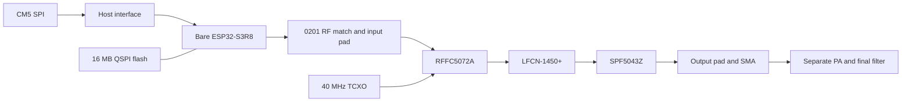

# Yapogee S3

Bare ESP32-S3 DVB-S2 transmitter daughterboard for PigeonVision. The CM5 supplies MPEG-TS over SPI. The S3 encodes and pulse-shapes the waveform through its own 2.42 GHz radio. An RFFC5072A with a 3.70 GHz LO converts it to 1.28 GHz; an SPF5043Z driver feeds the separate PA/filter board. High-side conversion requires transmit IQ conjugation or an equivalent receiver setting.

Open the [KiCad project](kicad/YapogeeS3.kicad_pro). [Project and library setup](kicad/README.md).

[BOM by circuit block](BOM.csv) · [BOM grouped by MPN](BOM_by_MPN.csv)

| Block | Selected part |
| --- | --- |
| MCU / PSRAM | ESP32-S3R8, bare QFN; 8 MB in-package octal PSRAM |
| Flash / MCU crystal | W25Q128JVSIQ; ABM8-40.000MHZ-10-D1G-T |
| Converter / reference | RFFC5072ATR13; ATXAIG-13-A-40.000MHZ-E05-T3 |
| RF driver / filter | SPF5043Z; LFCN-1450+ |
| Digital supply | TPS62933FDRLR, nominal 3.296 V |
| Quiet RF supply | TPS7A2030PDBVR, 3.0 V |
| Driver power / reset | TPS22919DCKR; TLV803EA30DBZR |

| Interface | Design basis |
| --- | --- |
| Power | Nominal 5 V from the carrier; local digital and RF regulation |
| Payload | 3.3 V SPI, READY and PA-enable; quad data pins reserved |
| Modem | Bare ESP32-S3R8 with 8 MB octal PSRAM; external flash and crystal |
| Conversion | 2420 MHz input, 3700 MHz LO, 1280 MHz output |
| RF output | 50 ohms into the separate PA/filter board |
| Service | Data-only USB programming, powered from board 5 V; boot/reset and UART test access |

All BOM symbols and footprints resolve in the shared `PigeonVision` library. Standard packages reuse KiCad or carrier assets; package-specific lands follow manufacturer drawings. The three S3 RF matching components use 0201 packages. Most other small passives use 0402, with larger power and driver parts where specified.

The schematic is still a starter; component selection and library checks do not establish circuit connectivity. The carrier needs the matching GH12 interface wiring. Layout uses a four-layer, 1.6 mm FR4 basis with continuous ground under RF; the fabricator stackup and impedance geometry remain to be set. RF matching, synthesizer configuration, spectrum, thermal behavior and clean PA power need hardware verification before fabrication release.
