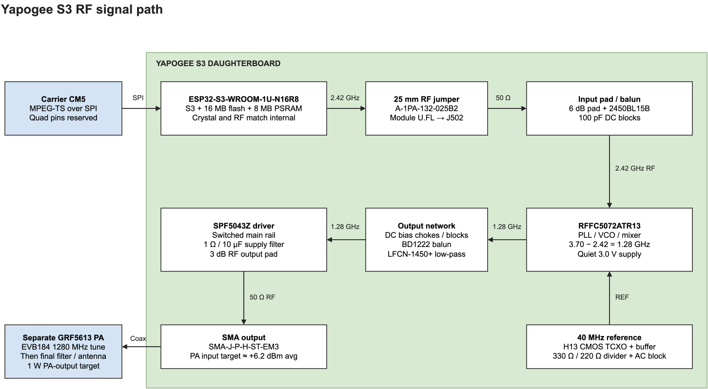
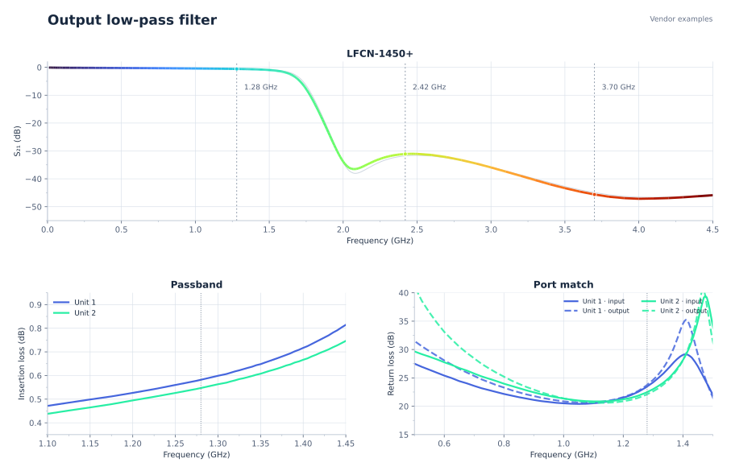
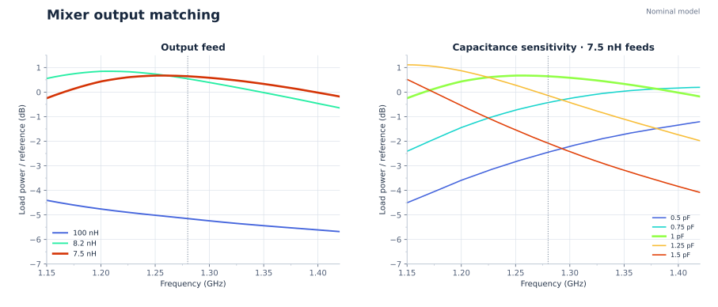

# Yapogee S3

DVB-S2 transmitter daughterboard for PigeonVision. CM5 SPI feeds an ESP32-S3-WROOM-1U-N16R8. RFFC5072A converts 2.42 GHz to 1.28 GHz using a 3.70 GHz LO. High-side conversion requires IQ conjugation.

[KiCad project](kicad/YapogeeS3.kicad_pro) · [Design Master](design-master.xlsx) · [Datasheet PDFs](datasheets.md) · [BOM](BOM.csv) · [Interfaces](interfaces.md)

[Edit diagram](block-diagram.drawio)

| Block | Part |
| --- | --- |
| MCU | ESP32-S3-WROOM-1U-N16R8 |
| RF jumper | A-1PA-132-025B2, 25 mm |
| Mixer / LO | RFFC5072ATR13 |
| Reference | ATXAIG-H13-F-40.000MHZ-F25-T3 + 74LVC1G34GV,125 |
| Driver / filter | SPF5043Z + LFCN-1450+ |
| Main supply | TPS62933FDRLR, 3.328 V nominal |
| Main inductor | Bourns SRP5030TA-2R2M, 2.2 µH |
| Quiet RF supply | TPS7A9001DSKR, 3.000 V nominal |
| Shield | BMI-S-206-F / BMI-S-206-C |

Current BOM: 119 purchased fitted positions, 59 unique MPNs and 0 DNP positions. The 15 PCB connector, jumper and test features are excluded from that purchase count; the shield lid and RF jumper are separate offboard items. This is the prototype population, not an assembly release.

JP1 is open for external power. Close it for standalone USB power before installation, with the carrier disconnected. Mounted JP1 stays open; USB data requires the carrier on. Independent Pi PMIC-off operation is unsupported. USB operation requires a known 5 V source providing at least 1.5 A. The external PA has a separate supply.

The host uses direct 3.3 V GPIO; the RF control translator remains. BOOT/RESET use normally-open PCB jumper pads. Native USB programming is local to the ESP32. Neither endpoint may drive an unpowered receiver. RF capture is complete; placement, routing and carrier integration remain. Four-layer, 55 × 43.18 mm outline carried by J1. Stability, RF, thermal and mechanical performance remain to be measured.

## RF response

Manufacturer filter examples and nominal matching calculations. [Sources and model limits](plots/README.md).

