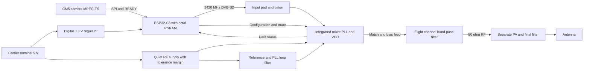

# Yapogee S3

Yapogee S3 is PigeonVision's proposed ESP32-S3 transmitter board. The CM5 supplies MPEG-TS over SPI; the S3 performs DVB-S2 encoding and pulse shaping through its own radio. An integrated mixer, PLL and VCO translate the resulting 2.42 GHz RF signal to approximately 1.28 GHz. The board takes nominal 5 V from the carrier and feeds a separate PA/filter board through a 50 ohm RF interface.

The [original Yapogee](https://github.com/Rivercraft911/yapogee) uses RP2350B, AFE7071 and an external LO. This version retains the name while replacing that waveform-generation hardware. Schematic capture and layout for the S3 board have not started on this branch.

## Board interfaces

| Interface | Working requirement |
| --- | --- |
| Input power | Nominal 5 V from the carrier; tolerance, ripple, transient limits and current budget remain to be specified |
| Payload | 3.3 V single-line SPI plus READY, using PV-SPI v1; quad input is an expansion option |
| Modem | ESP32-S3 with firmware-compatible memory; demonstrated boards have 8 MB octal PSRAM |
| Source RF | 2420 MHz working center; output power and waveform peaks require calibrated measurement |
| Converted RF | Provisional 1240-1300 MHz tuning envelope; 1280 MHz example center |
| RF output | 50 ohms into a separate PA/filter board; required drive and maximum permitted power remain open |
| Service | Programming, configuration, reset, mute and fault/status access; final pins and connector remain open |

The new board needs local regulation. A 5 V input does not imply 5 V RF supplies or logic. For RFFC2072A, the recommended supply range is 2.7-3.3 V: nominal 3.3 V leaves no positive tolerance or ripple margin. Choose its rail and digital interface together, accounting for supply ramp, power-off pin limits and startup. Its published 106/132 mA low/high-bias currents at a 1 GHz LO are typical figures, not a board current limit. [Qorvo datasheet, Rev F, pp. 2-3](https://www.qorvo.com/products/r/ra000701).

## Converter candidates

RFFC2072A and RF2052 are the two starting candidates. RF2052 offers lower typical power and cost. Both integrate the mixer, PLL and VCO and cover the proposed conversion. Final selection depends on drive level, distortion, phase noise, matching and sourcing, rather than IIP3 alone. They are not pin compatible.

| Candidate | Published high-linearity IIP3 | Published typical total current | Recommended supply |
| --- | ---: | ---: | ---: |
| [RF2052](https://www.qorvo.com/products/p/RF2052) | +18 dBm | 55-75 mA at 3 V | 2.7-3.6 V |
| [RFFC2072A](https://www.qorvo.com/products/p/RFFC2072A) | +23 dBm | 106-132 mA with 1 GHz LO | 2.7-3.3 V |

These figures have different test conditions and do not establish performance for 2420 MHz input and 1280 MHz output. See the [linearity estimate](analysis/README.md) for what the available specifications can and cannot predict. RFFC5072A is another integrated candidate if its wider frequency range or sourcing becomes useful.

## Frequency conversion and filtering

With low-side injection, `f_out = 2420 MHz - f_LO`. LO tuning from 1180 to 1120 MHz covers output centers from 1240 to 1300 MHz. At the example center, `2420 - 1140 = 1280 MHz`; the sum product is 3560 MHz.

Use band-pass filtering, or equivalent lower- and upper-side rejection, before the PA. A low-pass filter alone would pass the 1140 MHz LO leak. ESP32 carrier leakage at 2420 MHz translates to the wanted center and cannot be removed by that filter. Match the differential mixer ports and provide their required DC blocking and output supply feed; neither port is a direct 50 ohm connection.

For bandwidth `B` within the provisional 1240-1300 MHz envelope, zero-guard centers satisfy `1240 + B/2 <= f_center <= 1300 - B/2`, in MHz. A 13.5 MHz waveform allows 1246.75-1293.25 MHz centers before extra guard; a 40 MHz waveform allows only 1260-1280 MHz. Filter skirts, frequency error and coordination require additional margin. Keep converter bandwidth up to 40 MHz as an expansion goal; select the flight filter after the actual channel is known.

## Waveform and ground receiver

For the demonstrated approximately 8 Mb/s camera mux, QPSK 1/2 at 10 Msym/s, normal frames, pilots and roll-off 0.35 is the primary margin candidate. It has 13.5 MHz nominal bandwidth and capacity:

`10e6 * (32208 - 80) / (32400 + 90 + 22*36) = 9.653266 Mb/s`.

It cannot carry a continuously full 9.68 Mb/s source. 8PSK 2/3 at 5 Msym/s provides 9.678 Mb/s in 6.75 MHz and remains the demonstrated narrower fallback. QPSK 3/4 at 10 Msym/s provides 14.521 Mb/s for a higher source rate.

Using ETSI's ideal AWGN thresholds, QPSK 1/2 at 10 Msym/s needs about `6.62 - 1.00 - 10*log10(2) = 2.61 dB` less received power than 8PSK 2/3 at 5 Msym/s, at approximately equal capacity. This excludes receiver implementation loss and any change in usable PA output. Both pulse-shaped constellations have envelope variation; do not assign a fixed PA-backoff advantage to QPSK. [ETSI EN 302 307-1 V1.4.1, Table 13](https://www.etsi.org/deliver/etsi_en/302300_302399/30230701/01.04.01_60/en_30230701v010401p.pdf).

The current S3 receiver's documented rates are 1 and 5 Msym/s. A 10 Msym/s flight mode therefore needs a suitable SDR receiver or further S3 receiver development. An S3 ground receiver also needs RF conversion from the flight band into its supported input range.

## Evidence and next design decisions

The ESP32 modem evidence is pinned to [f614979](https://github.com/Rivercraft911/esp-dvbs2/tree/f6149796044796f83fe10a27dc381554df21a2d8):

- [CM5 SPI tests](https://github.com/Rivercraft911/esp-dvbs2/blob/f6149796044796f83fe10a27dc381554df21a2d8/results/2026-10-23-ota-spi-input/README.md) include 14.52 Mb/s QPSK 3/4 at 10 Msym/s through a conducted B200/LeanDVB path.
- [Two-camera demo](https://github.com/Rivercraft911/esp-dvbs2/blob/f6149796044796f83fe10a27dc381554df21a2d8/results/2026-10-23-live-demo/README.md) records 2.4 hours across successive 2420 MHz coax runs, including the remaining transport losses.
- [SPI input](https://github.com/Rivercraft911/esp-dvbs2/blob/f6149796044796f83fe10a27dc381554df21a2d8/docs/spi-input.md) distinguishes CM5 single-line input, quad loopback and parser replay. Quad CM5 input remains unqualified.
- [Receiver implementation](https://github.com/Rivercraft911/esp-dvbs2/blob/f6149796044796f83fe10a27dc381554df21a2d8/docs/receiver.md) describes its supported rates and decoder limits.

Before fixing the RF components, measure ESP32 average power, peaks, spectrum and MER versus drive; compare converter loss and added distortion; then determine the PA input needed at a permitted clean output power. Qualify the actual ground receiver and the complete 5 V power/startup interface.

Flight channel, bandwidth, power and retuning access require coordination against the current [ESRA documents](https://www.esrarocket.org/documents-and-forms), including the [2027 DTEG Rev P1](https://www.esrarocket.org/s/2027-IREC-DTEG-REV-P1.pdf). The 0.5 W PA value in legacy documentation remains an unverified planning target.
