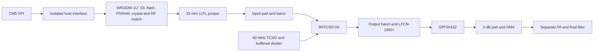

# Yapogee S3

ESP32-S3 DVB-S2 transmitter daughterboard for PigeonVision. The CM5 supplies MPEG-TS over SPI, with quad data pins reserved. An ESP32-S3-WROOM-1U-N16R8 module generates the waveform at its matched 2.42 GHz RF port. A short U.FL jumper feeds the RFFC5072A; a 3.70 GHz LO converts it to 1.28 GHz. High-side conversion requires transmit IQ conjugation or equivalent receiver handling.

Open the [KiCad project](kicad/YapogeeS3.kicad_pro). The schematic remains unwired. The PCB has mechanical reference placements; complete component placement and routing remain.

[Circuit BOM](BOM.csv) · [BOM by MPN](BOM_by_MPN.csv) · [Shield lid](BOM_mechanical.csv) · [RF jumper](BOM_offboard.csv) · [Interfaces](interfaces.md)

| Block | Selected part |
| --- | --- |
| MCU module | ESP32-S3-WROOM-1U-N16R8; 16 MB flash, 8 MB octal PSRAM |
| RF link | A-1PA-132-025B2 jumper; U.FL-R-SMT-1(80) board socket |
| Converter / reference | RFFC5072ATR13; ATXAIG-H13-F-40.000MHZ-F25-T3 with 74LVC1G34GV,125 |
| RF driver / filter | SPF5043Z; LFCN-1450+ |
| Main / quiet RF power | TPS62933FDRLR, nominal 3.328 V; TPS7A9001DSKR, nominal 3.0 V |
| Source selection / USB detection | TPS2116DRLR; STUSB4500LQTR and SN74LVC1G97DBVR |
| Output / shield | SMA-J-P-H-ST-EM3; BMI-S-206-F frame and BMI-S-206-C lid |

USB-C supports standalone operation from a source advertising at least 1.5 A. Carrier power enters through castellations. Eligible USB wins when both sources are present. The external PA has its separate supply. USB VBUS must stay at or below the source selector's 5.5 V recommended maximum.

Selected 5 V feeds the main buck and the separate quiet RF LDO. The module, interface and switched driver use the main rail. The converter, TCXO and buffer use quiet 3.0 V; retain the RF control level translator. This preserves the mixer’s nominal characterization supply and margin below its 3.3 V operating ceiling. The LDO needs its thermal pad, bulk capacitors, feedback network and minimum-load bleeder.

The 53 × 40 mm starting envelope retains 16 interface positions and three GND anchors. The module and RF jumper have nominal poses under the removable shield; actual cable length, bend, retention and mated height need a sample check. The SMA carrier relief remains a proposal. The original carrier PCB is unchanged.

The module internalizes the chip RF match, crystal, flash and local high-speed memory routing. No 0201 parts remain in the selected PCB BOM. The [four-layer fabrication basis](stackup.json) uses JLC04161H-7628 with continuous L2 GND; actual stackup entry and impedance widths remain.

RF matching, PLL configuration, reference loading/phase noise, source transitions, thermal behavior and modulated power need hardware qualification. SPF5043Z uses its approximately 3 V typical characterization for the switched main-rail branch; its recommended-voltage table remains 4.75–5.25 V. Clean 1–2 W from the separate PA is a hardware target.
