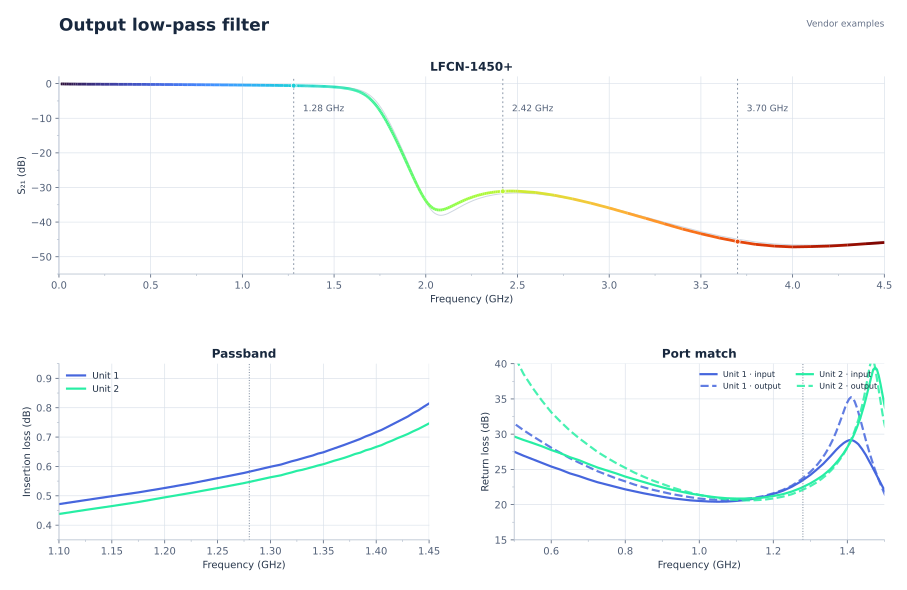
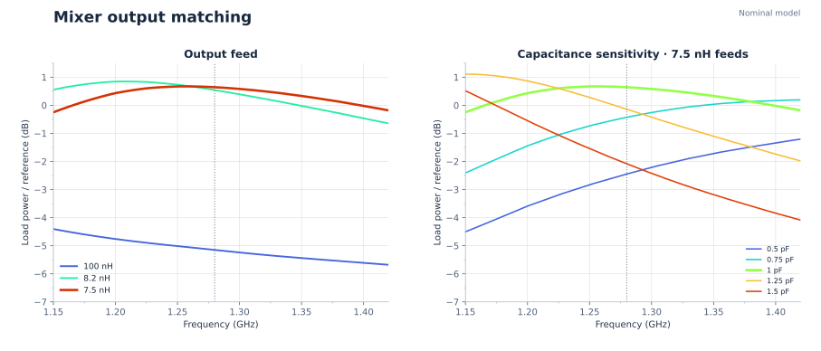
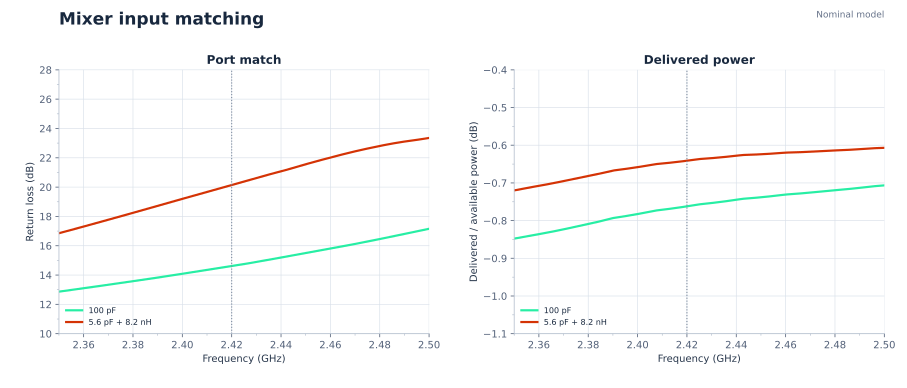

# RF model figures

These figures show manufacturer example data and nominal linear circuit calculations. They do not establish assembled PCB performance.

LFCN-1450+ response replotted from Mini-Circuits’ two 2012 example-unit S-parameter files: 50 Ω, −10 dBm, TB-270 with port extension. The rainbow trace is unit 1; gray is unit 2. The plots describe the filter alone. [Manufacturer data](https://www.minicircuits.com/pages/s-params/LFCN-1450%2B_S2P.zip).

Complex nodal calculation using the [TTM BD1222J50200AHF S₃P](https://cdn.ttm.com/repository/products/wireless-xinger/balun-transformers/BD1222J50200AHF/BD1222J50200AHF.s3p), precise [Murata passive models](https://ds.murata.com/simserve/), and Qorvo’s typical output: 2 kΩ ∥ 1 pF, 0.5 nH bond wire per leg. The ordinate compares load power with an ideal 200 Ω reference; it is not mixer conversion gain. Capacitance sensitivity is illustrative, not a tolerance bound. PCB geometry and supply-bypass impedance are excluded.

Complex nodal calculation using [Johanson balun S₃P](https://www.johansontechnology.com/docs/1458/2450BL15B100_wxX6Gtp.s3p), precise Murata models, and Qorvo’s typical input at default bias 4: 85 Ω ∥ 0.5 pF, 0.5 nH bond wire per leg. The 3 dB input pad is excluded. Bias 6 port impedance remains unknown; the alternate matching network is shown only for comparison.

[Qorvo matching models](https://www.qorvo.com/products/r/ra000753). Hardware output power, EVM, temperature behavior and PCB matching remain unmeasured.
